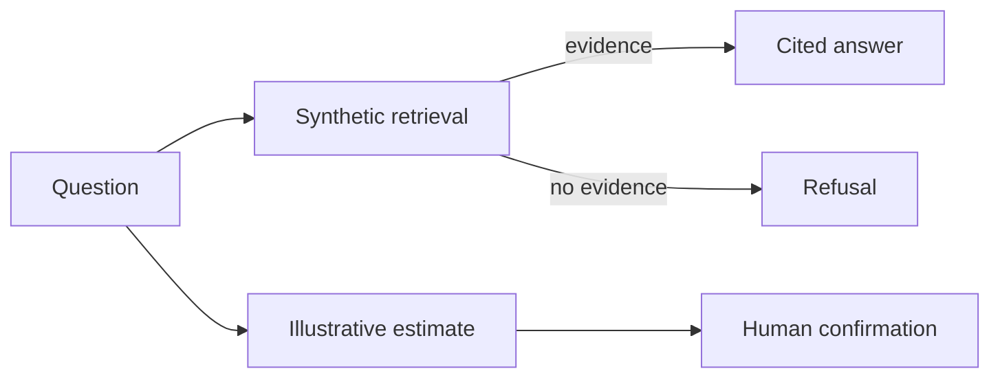

# Mistral Tax Agent

> A citation-first agent reference using a completely fictional tax jurisdiction, explicit refusals, confirmed calculations, traces, and offline evals.



## Quickstart

```bash
make test
make eval
make demo
```

## What I built

- Every supported answer includes source identifiers.
- Unsupported real-world questions fail closed.
- Calculations require approval and use fictional currency.
- Ten scenarios run across 30 trials.

## What is mocked

The jurisdiction, rules, sources, rate, deadline, and currency are fictional; mock mode uses no model or provider credential.

## Known limitations

The compact keyword retriever demonstrates grounding and refusal behavior, not real-world tax coverage or legal accuracy.

This is not tax advice and contains no real tax authority material or API credential. See [SECURITY.md](SECURITY.md) and [PROVENANCE.md](PROVENANCE.md).
